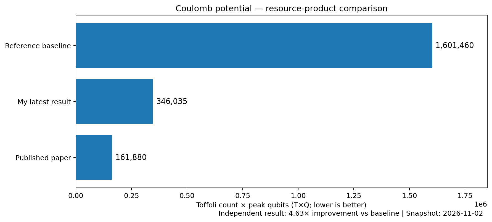

# LLM-Assisted Quantum Circuit Optimization — Independent Research Notes

**Public research note v0.4 · Coulomb potential · Research snapshot: 2026-11-02 (Asia/Taipei)**

> **Work in progress.** This is a dated results report, **not** a runnable replication package or a state-of-the-art claim. The results below are documented in private VM audit and experiment handoff records. The latest candidate and complete evaluation logs have **not** been exported into this public repository; external reproduction is not yet possible from these files alone.

## From a published result to an independent experiment

Inspired by Gu *et al.* (2026), [*Discovering state-of-the-art quantum circuits with large language models*](https://arxiv.org/abs/2610.22367), this project asks whether an independently assembled, resource-conscious LLM-assisted workflow can find better reversible quantum circuits. It combines a coding agent, evolutionary search, and the original [uncompute](https://github.com/andigu/uncompute) evaluator. Most of the study's implementation remains unpublished while experiments continue.

## Coulomb potential: updated result

The resource-product objective is **T×Q**: Toffoli count × peak qubit count, **not** running time.

| Result | T×Q | Improvement vs. baseline |
|---|---:|---:|
| Reference baseline | **1,601,460** | 1.00× |
| This project's earlier public snapshot (2026-10-27) | **450,385** | 3.56× |
| **Latest evaluator-validated result in the treatment database (2026-11-02)** | **346,035** | **4.63×** |
| Gu *et al.* published result | **161,880** | 9.89× |

The latest candidate reduces T×Q by **78.4%** versus baseline. The best candidate is recorded in an **isolated experimental database (117 programs)**. A separate production database (79 programs) remained at **348,775**, deliberately unchanged during this controlled comparison. **The T and Q components and full source for the 346,035 candidate have not yet been exported into the supplied handoff.** Evaluator acceptance is not a formal proof of functional equivalence.

## Exploratory comparison: research-agent configurations

An exploratory five-round-per-arm comparison used two separately evolving experimental configurations, starting from identical databases of 79 candidates. **Configuration details are not yet disclosed**; the comparison is presented as an observed research outcome, not as evidence for a particular technique.

| Five-round outcome | Configuration A | Configuration B |
|---|---:|---:|
| Retained SHA-unique, evaluator-validated new candidates | 9 | **38** |
| Best newly produced candidate T×Q | 415,529 | **346,035** |
| Final database-wide best T×Q | 348,775 | **346,035** |

Configuration B retained **4.22×** as many unique candidates, and its best newly produced candidate had **16.7%** lower T×Q than the best new candidate under A. However, the *final database-wide best* improved by only **0.79%** relative to the identical starting best of 348,775. These comparisons use **different denominators** and should not be conflated.

**Limitations:** only five rounds per configuration; later runs did not use matched parents; candidates within a session are not statistically independent; the configurations differ in more than one respect. These observations **do not establish causality, statistical significance, or generalization** to the other seven benchmarks.

## Recorded research spending (billing snapshot, 2026-11-02)

| Item | USD |
|---|---:|
| Google Cloud usage, after shown discounts, before tax | $96.00 |
| Google Cloud tax shown | $5.00 |
| DeepSeek API cumulative charges | $17.15 |
| **Combined charges including shown tax** | **$118.15** |

The author estimates approximately **$15–$20 of Google Cloud charges** arose from extended VM idle time. These are account charges, **not** a rigorous per-experiment cost or a controlled price/performance measurement. They include development and nonproductive time; the latest experiment's marginal costs have not been isolated.

## Disclosure and attribution

This project currently covers **one of eight tasks** in the paper. The evaluator, benchmark, general LLM/evolutionary search concepts, and third-party tools are credited in [REFERENCES.md](REFERENCES.md). The independent contributions so far include assembling and operating the workflow and documenting its empirical performance.

Detailed prompts, agent configuration, orchestration, search policies, candidate source code, and private evaluation records are **not included**. We intend to publish a more complete implementation after the study is sufficiently mature and reviewed for safety, licenses, and attribution. See [RESULTS.md](RESULTS.md) and [RIGHTS.md](RIGHTS.md).

[繁體中文](README_zh-TW.md) · [Earlier 2026-10-27 public result snapshot](data/public-results-2026-10-27.json)
