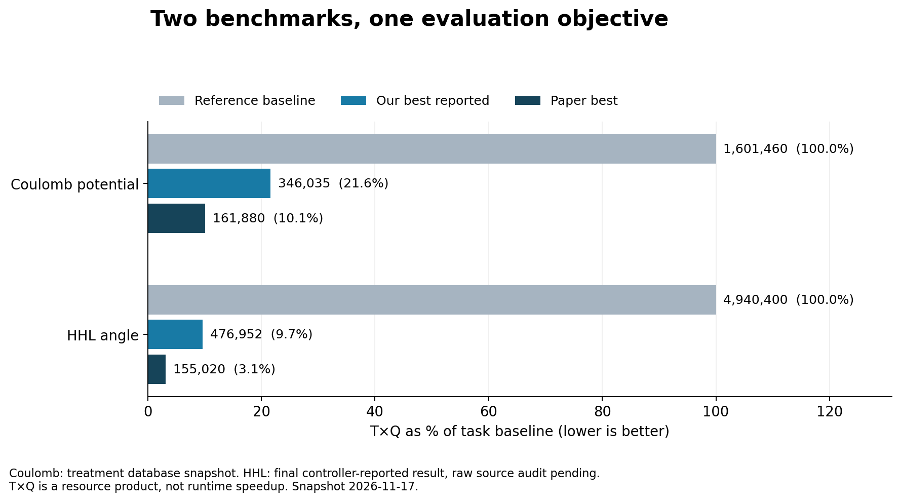

# Quantum Circuit Evolution

Independent, bounded LLM-guided optimization of two fault-tolerant quantum arithmetic circuits, following Gu et al., [*Discovering state-of-the-art quantum circuits with large language models*](https://arxiv.org/abs/2610.22367). DeepSeek + OpenCode + OpenEvolve (0.4.0). Research snapshot: 2026-11-17. [繁體中文](README_zh-TW.md)

## Results

| Task | Paper baseline TQ | Our best T × Q | Our best TQ | Gain vs baseline | Paper best TQ |
|---|---:|---:|---:|---:|---:|
| Coulomb potential | 1,601,460 | 1,955 × 177 | **346,035** | **4.63×** | 161,880 |
| HHL angle | 4,940,400 | 2,839 × 168 | **476,952** | **10.36×** | 155,020 |



Both best circuits were rebuilt from the archived source and passed the original native evaluator in a fresh offline replay; all checked shots passed. The HHL stream SHA-256 matches the original evaluation-time stream. The results improve the paper baselines, but do not surpass the paper's discovered circuits. HHL closed below the planned 12× target. Native sampled acceptance is not exhaustive correctness proof.

## Reproduce results without an LLM

Use Python 3.10+ (original VM used 3.12). Run from the repository root:

```bash
python -m venv .venv
source .venv/bin/activate
pip install -r requirements.txt
python tools/verify_archive.py
python tools/reproduce.py both
```

The replay builds from candidate source, emits an op stream, and grades it with the actual task-specific native grader and shared evaluator. It forces the original pure-Python kernel fallback; no API key, VM, network call after installation, or paid search is required. Candidate code is executable research code; review it before running, and use an isolated environment. Output reports are written to `replay-output/`. Archived reports are in each task's `data/` directory. The full historical paid VM workflow is **not** a turnkey portable install.

## Cross-task design

- `uncompute/`, `tools/eval.py`: common upstream Builder, serializer, evaluator. The 25 Python modules and evaluation CLI supplied by both VM exports are byte-identical.
- `tasks/coulomb-potential/`: original task spec, native grader, candidate archive, three separate database membership tables, Coulomb-specific production/control/treatment controllers and memory/inspiration sidecar.
- `tasks/hhl-angle/`: native grader, 37 source-bound newly admitted candidates (plus two prior seeds), submission manifests, compressed original OPS, controller implementation and session data. Both independent algorithm families reached Gen4.
- `data/results.json`: common machine-readable comparison; `tools/verify_archive.py` validates the task archives. Candidate IDs and ancestry are task-local.
- `docs/`: boundaries of reproduction, evidence, and research design. `history/`: previous Coulomb v0.4 public research note.

This is a genuinely shared circuit/evaluation substrate with task-specific search implementations, not a claim that one identical search controller or direct circuit transfer was tested across tasks. Coulomb's earlier selective-inspiration experiment informed HHL's P11 research layer. A causal attribution of gains to that layer requires further analysis; no such attribution is made here.

## Citation and rights

Upstream uncompute: [andigu/uncompute](https://github.com/andigu/uncompute), Apache-2.0; the bundled upstream license is in `LICENSES/`. See [REFERENCES.md](REFERENCES.md) and [RIGHTS.md](RIGHTS.md). The paper's authors are not authors of this independent replication. Original research code/data are made available for inspection; no additional open-source license is implied unless the rights holder explicitly chooses one. Review original contributions' rights before public release.
