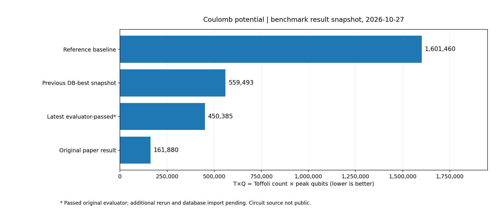

# LLM 輔助量子電路最佳化：獨立研究紀錄

**公開研究紀錄 v0.3｜Coulomb potential｜2026-10-27（臺灣時間）**

> **研究進行中；此為初步成果報告，不是可重現的程式釋出。** 最新候選已通過**原論文 Evaluator**，依交接紀錄，其評估結果與電路程式快照已備份並核對一致性；但**尚未完成額外重跑，也尚未回存演化資料庫**。此公開版本不含候選電路與評估日誌，外部讀者無法僅用本 repo 重現結果。

## 研究問題

以個人可負擔的模型與運算資源，結合 LLM Coding Agent、演化式搜尋及原始評估器，能否降低可逆量子電路的資源成本？

這項個人 AI for Science 實驗受到 Gu 等人（2026）[《Discovering state-of-the-art quantum circuits with large language models》](https://arxiv.org/abs/2610.22367) 啟發。它並不宣稱重現原作者完整系統、發明此類搜尋方法，或達到原研究最佳結果。

## Coulomb potential：已取得的初步成果

目標指標為 **T×Q**：Toffoli gate 數目 T 乘以評估器計算的最大同時使用 qubit 數 Q。

| 比較對象 | Toffoli T | Qubits Q | T×Q 成本 | 相對基準改善 |
| --- | ---: | ---: | ---: | ---: |
| 原始基準 | 6,355 | 252 | **1,601,460** | 1.00 倍 |
| 前次確認的資料庫最佳值 | — | — | **559,493** | 2.86 倍 |
| **最新通過原 Evaluator 的候選（2026/10/27）** | **2,197** | **205** | **450,385** | **3.56 倍** |
| 原論文報告的最佳值 | 1,140 | 142 | **161,880** | 9.89 倍 |

最新候選相對基準將 T×Q **降低約 71.9%**；這是電路資源指標，**不是執行時間縮短 3.56 倍**。原論文成果仍顯著優於目前結果。

### 驗證層級與目前狀態

- 依最新實驗交接紀錄，原始 Evaluator 對此候選回報 **`valid=true`**，並測得 **T=2,197、Q=205**；相關程式及結果快照已備份，並做過檔案一致性核對。
- **額外重跑、資料庫回存及回存後檢查仍未完成。** 因此，450,385 是「**目前最佳已通過原 Evaluator 的候選**」，不是「目前已確認的資料庫最佳值」。前一次資料庫快照的最佳仍是 559,493。
- 原 Evaluator 按其指定測試檢查行為，**並不構成全部輸入情況的形式化正確性證明**。
- 這些資訊來自有日期的私人交接與執行紀錄，並非已對外公開、可第三方獨立稽核的證據。

目前僅探索原研究**八項任務中的 Coulomb potential 一項**。

## 公開範圍及未公開 know-how

研究大方向是 LLM Coding Agent、演化搜尋與原 Evaluator 的整合；**完整 Prompt、Agent 工作流程、演化／挑選設定、控制器程式、候選電路及實驗日誌暫不公開**。因此本 repo 是**研究進度紀錄，而非完整開源重現套件**。

使用的 DeepSeek、OpenCode、OpenEvolve/MAP-Elites 與原作者 [uncompute 評估器](https://github.com/andigu/uncompute)，均於[引用與致謝](REFERENCES.md)標示來源。更多細節見[結果與驗證狀態](RESULTS.md)及[權利說明](RIGHTS.md)。研究仍在進行中，後續視成果、可重現性及發表規劃再決定公開方式。

[English README](README.md)
