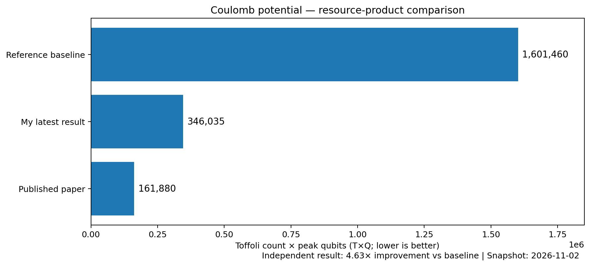

# LLM 輔助量子電路最佳化：獨立研究紀錄

**公開研究紀錄 v0.4｜Coulomb potential｜研究資料截至 2026-11-02（臺灣時間）**

> **研究仍在進行中。** 本專案目前是研究成果紀錄，**不是**完整可執行的重現套件，也不宣稱達到原論文最佳結果。下列數據依私人 GCP VM 稽核及交接紀錄整理；最新電路完整源碼與原始評估日誌尚未匯入公開 repo，因此外部無法僅憑本 repo 重現。

## 研究背景

受到 Gu 等人（2026）[《Discovering state-of-the-art quantum circuits with large language models》](https://arxiv.org/abs/2610.22367) 啟發，這項個人 AI for Science 研究嘗試以可負擔的 LLM、Coding Agent、演化搜尋及原作者公開的 [uncompute](https://github.com/andigu/uncompute) Evaluator，改善可逆量子電路的資源成本。

## Coulomb potential：最新結果

研究指標為 **T×Q＝Toffoli gate 數量 × 最大同時使用 qubit 數**，不是實際執行速度。

| 項目 | T×Q | 相對基準改善 |
|---|---:|---:|
| 原始基準 | **1,601,460** | 1.00 倍 |
| 之前公開結果（2026/10/27） | **450,385** | 3.56 倍 |
| **2026/11/02 實驗資料庫最新已驗證成果** | **346,035** | **4.63 倍** |
| Gu 等人原論文最佳 | **161,880** | 9.89 倍 |

最新成果相對基準將 T×Q **降低約 78.4%**，且已記錄於**隔離的實驗組資料庫（117 個程式）**。正式研究資料庫（79 個程式）的最佳值則維持 **348,775**，沒有在對照實驗時合併改寫。最新 346,035 電路的 T、Q 分量與完整程式碼尚未從 VM 匯出到此次交接包，不應臆測其架構。通過 Evaluator 也不等於完成形式化正確性證明。

## 初步對照實驗：不同研究 Agent 設定

兩組各五輪，從相同的 79 個初始候選分別建立資料庫，觀察不同 Research Agent 設定的搜尋結果。**具體設定與調整策略暫不公開**；此處僅報告探索性觀察，不將差異歸因於特定機制。

| 五輪結果 | 設定 A | 設定 B |
|---|---:|---:|
| 保留且 SHA 唯一的已驗證新候選 | 9 | **38** |
| 五輪最佳新候選 T×Q | 415,529 | **346,035** |
| 最後資料庫全域最佳 T×Q | 348,775 | **346,035** |

設定 B 保留的不同新候選數為設定 A 的 **4.22 倍**；兩組「五輪最佳新候選」的 T×Q 相差約 **16.7%**。不過，若比較「資料庫最後全域最佳」，則僅較共同起點 **348,775 下降 0.79%**，這兩種比較口徑不能混用。

**限制：**每組僅五輪；後續 Parent 未一一配對；同一 Session 的候選並非統計獨立；兩組設定有多項差異。因此**不能推論特定機制的因果效果**，也不能宣稱統計顯著或可推廣至其他七個任務。

## 累計帳單（2026/11/02 截圖）

| 項目 | 美元 |
|---|---:|
| Google Cloud 顯示折扣後、未稅小計 | $96.00 |
| Google Cloud 顯示稅金 | $5.00 |
| DeepSeek API 累計消費 | $17.15 |
| **合計（含畫面稅金）** | **$118.15** |

其中你估計約 **$15–$20 的 GCP 費用來自 VM 長時間閒置**。這是已記錄的帳單金額，**不是單次實驗的純運算成本**；尚未核算完整的每次搜尋／每美元表現。

## 公開範圍

研究目前僅涵蓋原論文**八項任務中的一項**。原論文、任務、Evaluator 以及第三方工具皆於 [REFERENCES.md](REFERENCES.md) 標明出處；目前的獨立工作包括系統整合、實驗執行與結果整理。

完整 Prompt、Agent 設定、控制器、演化策略、候選電路及私有日誌**暫不公開**，未來研究更成熟後，計畫整理可重現的程式與證據再釋出。詳見 [RESULTS.md](RESULTS.md)、[RIGHTS.md](RIGHTS.md)。

[English README](README.md) · [2026/10/27 舊版成果紀錄](data/public-results-2026-10-27.json)
